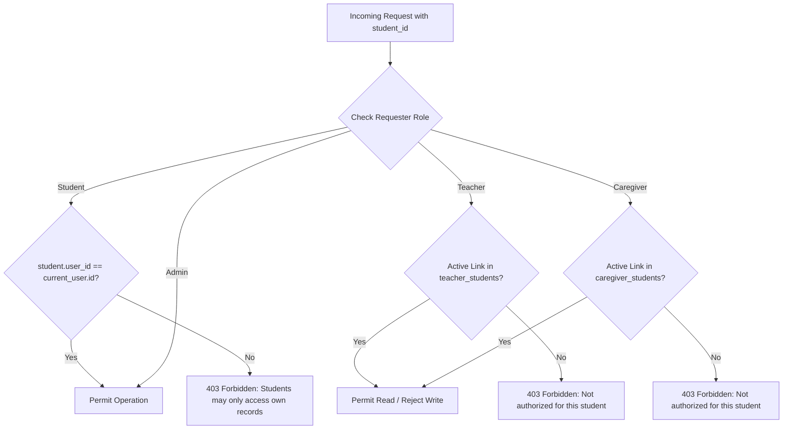

# AbleNova — Student Profile & Accessibility Preferences API Architecture

## 1. Overview & Accessibility-First Philosophy

AbleNova is designed specifically for children with disabilities in remote and underserved environments.

> [!IMPORTANT]
> **Core Principle**: The platform must adapt to the learner's accessibility needs. Learners must never be forced to adapt to a rigid interface.
> Accessibility preferences represent **functional assistive learning accommodations**, NOT medical diagnoses. The platform collects zero diagnostic, medical, or clinical information.

---

## 2. API Endpoints Specification

Mounted under `/api/v1`:

| Endpoint | HTTP Method | Authorized Roles | Description |
| :--- | :--- | :--- | :--- |
| `/api/v1/student/profile` | `GET` | Student | Retrieves current authenticated student's profile and accessibility settings. |
| `/api/v1/student/profile` | `PUT` | Student | Updates current student's editable attributes (`name`, `age`, `grade`, `preferred_language`, `accessibility`). |
| `/api/v1/student/profile/{student_id}` | `GET` | Student (Self), Linked Teacher, Linked Caregiver, Admin | Retrieves permitted student profile. Strictly rejects unlinked or unauthorized callers. |
| `/api/v1/student/profile/{student_id}` | `PUT` | Student (Self), Admin | Updates student profile by ID. Strictly rejects teachers and caregivers. |
| `/api/v1/student/accessibility` | `GET` | Student | Retrieves current student's standalone accessibility preferences. |
| `/api/v1/student/accessibility` | `PUT`, `PATCH` | Student | Updates current student's accessibility preferences (supports partial updates). |
| `/api/v1/student/accessibility/{student_id}` | `GET` | Student (Self), Linked Teacher, Linked Caregiver, Admin | Retrieves student accessibility preferences by student ID. |
| `/api/v1/student/accessibility/{student_id}` | `PUT`, `PATCH` | Student (Self), Admin | Updates accessibility preferences by ID. Strictly rejects teachers and caregivers. |

---

## 3. Role-Based Access Control & Child Data Protection

To protect minors from Insecure Direct Object Reference (IDOR) attacks, all ID-based endpoints pass through `verify_student_access`:



### Access Matrix Summary:
1. **Students**: Can access **only** their own profile and preferences. Passing another student's UUID immediately triggers `403 Forbidden`.
2. **Teachers**:
   - May view permitted educational profile and accommodations **only** for students actively linked in `teacher_students`.
   - Cannot view unlinked students (`403 Forbidden`).
   - **Cannot modify** student profiles or accessibility preferences (`403 Forbidden`: "Teachers and caregivers are not permitted to modify student accessibility preferences.").
3. **Caregivers**:
   - May view permitted profile and accommodations **only** for students actively linked in `caregiver_students`.
   - Cannot view unlinked students (`403 Forbidden`).
   - **Cannot modify** student profiles or accessibility preferences.
4. **Admins**: Permitted read and system management oversight.

---

## 4. Request & Response Schemas

### 1. `GET /api/v1/student/profile`
**Response (`200 OK`)**:
```json
{
  "student_id": "8c59f0f6-281b-4f91-a58f-b98a183492dc",
  "name": "Alice Student",
  "age": 10,
  "grade": 5,
  "preferred_language": "en",
  "accessibility": {
    "text_enabled": true,
    "audio_enabled": false,
    "captions_enabled": false,
    "simplified_content": false,
    "large_text": false,
    "high_contrast": false,
    "reduced_motion": false,
    "keyboard_navigation": true
  }
}
```

### 2. `PUT /api/v1/student/profile`
**Request (`PUT`)**:
```json
{
  "age": 11,
  "grade": 6,
  "preferred_language": "es",
  "accessibility": {
    "large_text": true,
    "high_contrast": true
  }
}
```
**Response (`200 OK`)**:
Returns the updated `StudentProfileResponse` reflecting the applied modifications.

### 3. `GET /api/v1/student/accessibility`
**Response (`200 OK`)**:
```json
{
  "student_id": "8c59f0f6-281b-4f91-a58f-b98a183492dc",
  "text_enabled": true,
  "audio_enabled": false,
  "captions_enabled": false,
  "simplified_content": false,
  "large_text": true,
  "high_contrast": true,
  "reduced_motion": false,
  "keyboard_navigation": true,
  "updated_at": "2026-11-14T13:50:00Z"
}
```

### 4. `PATCH /api/v1/student/accessibility`
**Request (`PATCH` or `PUT`)**:
```json
{
  "reduced_motion": true,
  "captions_enabled": true
}
```
> [!TIP]
> **Partial Update Guarantee**: Any omitted accessibility settings (such as `text_enabled`, `keyboard_navigation`) retain their current configured values without being reset to defaults.

---

## 5. Data Validation & Boundary Safeguards

- **Age Validation**: `3 <= age <= 25` (enforced via Pydantic validator).
- **Grade Validation**: `1 <= grade <= 12` (enforced via Pydantic validator).
- **Language Code**: `2 <= len(preferred_language) <= 10` (ISO 639-1 format preferred, e.g. `en`, `es`, `hi`, `fr`).
- **Protected Fields Guard**:
  - Profile update endpoints strictly reject/ignore mass-assignment attempts to modify account roles (`role`), identifiers (`id`, `user_id`, `student_id`), emails (`email`), or passwords (`password_hash`).
- **Privacy Boundary**:
  - Responses strictly exclude internal database IDs, passwords, hashes, authentication tokens, and unrelated records.
  - Zero medical, clinical, or diagnostic terminology is stored or transmitted.

---

## 6. Error Responses Format

Errors strictly conform to `API_CONTRACT.md` Section 20:

```json
{
  "error": {
    "code": "FORBIDDEN",
    "message": "Students may only access their own records"
  }
}
```

| HTTP Status | Error Code | Trigger Condition |
| :--- | :--- | :--- |
| `401 Unauthorized` | `UNAUTHORIZED` | Missing, expired, or malformed Bearer access token. |
| `403 Forbidden` | `FORBIDDEN` | Student accessing another student's UUID, unlinked teacher/caregiver access, or teacher/caregiver attempting to modify preferences. |
| `404 Not Found` | `NOT_FOUND` | Student record does not exist in the database. |
| `422 Unprocessable` | `VALIDATION_ERROR` | Non-boolean value for preference flag, age/grade out of allowed range, invalid payload format. |
